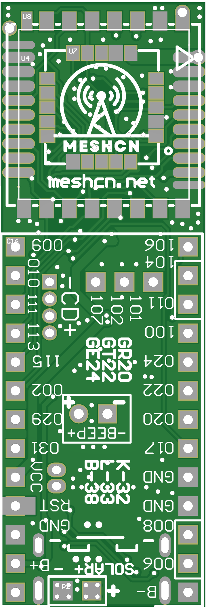
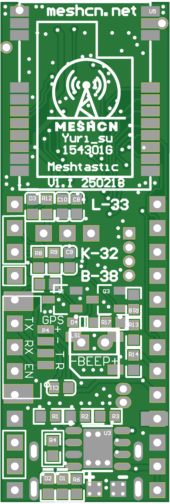

# FaketecYuri 組裝指南

感謝大陸網友無私開發此PCB版 [連結](https://github.com/Yurisu/meshtastic-faketecyuri)  

我利用此PCB搭配多款900Mhz Lora組裝成meshtastic節點穩定上線多時。 
在此分享在DIY時需要注意的地方，希望可以推廣"便宜治百病"的節點製作方式 

## 個人經驗: 
- 收訊品質: 節點位置對於遠大於 "模塊的選擇"
- 我的解決方案: ProMicro (14 RMB) + 4~10 RMB Lora模塊 + CN3163 0.5RMB +  ATH20+BMP280溫濕度傳感器 (3 RMB), 總價 200台幣內
- 多數妹婿推廣 XIAO nRF52840 + Wio-SX1262 , 優點組裝容易但是所費不貲(兩個加起來約600-700台幣)
- 管他黑貓白貓，只要會抓老鼠的，就是好貓
  
PS: 嗶波嗶波系列節點，多數都是搭配這塊PCB版製作，實測下來皆可穩定運行。 

 

## 模塊使用經驗:

| 廠家 | 型號 | 晶片 | 入手價 |
| :--- | :--- | :--- |:--- |
| **成都億佰特** | E220-900M22S |  LLCC68 | 4.1RMB |
| **大夏龍雀** | DX-LR30 |  SX1262 | 9.6 RMB |
| **大夏龍雀** | DX-LR20 |  LLCC68 | 5.9 RMB |
| **惠特自動化** | HT-RA62 |  SX1262 | 21.9 RMB |
| **河南安信可** | RA-01SH-P |  SX1262 | |

## 模組焊接補充說明

| 型號 | LORA悍盤阻焊說明 | 
| :--- | :--- | 
| **E22-900M22S** |  |
| **E220-900M22S** | PIN5(DIO3) **需**阻焊 |
| **DX-LR30** | PIN5(DIO3) **需**阻焊 |
| **DX-LR20** | PIN5(DIO3) **需**阻焊 |
| **RA-01SH-P** |3處需阻焊, 詳細請參考圖片 |

> **注意事項**：使用綠油或高溫膠帶進行絕緣阻焊。

## ADC 分壓電阻位置

- **電阻比例**：`2 : 3`
- **常用規格**：常見為 `1 MΩ : 1.5 MΩ`；實測亦可使用 `470 kΩ` 與 `680 kΩ`。
- 

---

## 功能模組

### 1. 整合太陽能充電

- **充電管理 IC**：[CN3163 充電管理晶片](https://item.szlcsc.com/582671.html?fromZone=s_s__%2522C559031%2522&spm=sc.gb.xh1.zy.n___sc.hm.hd.ss&t=1739525886502&s=1739525886502&lcsc_vid=FgJaXlFRTwdWBgAAEVBdAlEARwMIVVxUFVENAQdTRAAxVlNVTlRcUlxfR1FbXjtW)
- **溫度保護範圍**：`0 – 55°C`（由板載 NTC 設定）
- **NTC 彈性設計**：可拆除板載 NTC，替換為電池內部內建的 NTC
- **限流電阻**：`1.2 kΩ`（對應充電電流 `1000 mA`）
- **充電恆壓電壓**：`4.2 V`
- **輸入電壓範圍**：`4.4 – 6 V`
- **狀態指示**：具備充電中與充電完成之雙狀態指示輸出
