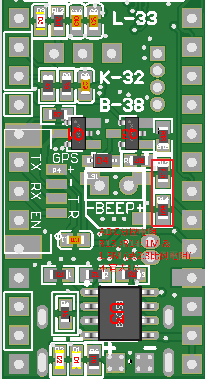

# FaketeYuri 組裝指南

感謝大陸網友無私開發此PCB版，個人已成功完成模塊組裝並上線穩定運行
台灣嗶波嗶波系列節點，多數藉由此PCB搭配各廠家 LORA模塊組裝完成

目前搭配過的模塊有:

| 廠家 | 型號 | 晶片 | 入手價 |
| :--- | :--- | :--- |

E-BYTE E220-900M22S (LLCC68)
大夏龍雀 DX-LR30 (SX1262)
大夏龍雀 DX-LR20 (LLCC68)
HT-RA62 (SX1262)
RA-01SH-P (SX1262)

個人經驗: 節點位置遠比模塊型號重要大得多，所以組裝，還是"便宜治百病"

透過這款PCB，我實作 :LORA + 太陽能充電IC + 溫溼度SENSOR, 整個組裝起來成本 可以壓在150台幣左右。
比起其他網友用XIAO NRF52840系列，便宜好幾倍。管他黑貓白貓，只要會抓老鼠的，就是好貓


### 4. LoRa 模組支援清單

| 廠家 | 型號 | 備註 / 連結 |
| :--- | :--- | :--- |
| **成都億佰特** | E22-400M22S | [購買連結](https://item.taobao.com/item.htm?id=571626367408&_u=e1fg9toef8a) |
| **成都億佰特** | E22-400MM22S | [購買連結](https://item.taobao.com/item.htm?id=571626367408&_u=e1fg9toef8a) |
| **深圳矽傳** | SX1268ZTR4 (433 MHz) | 拿樣含彈簧天線｜[購買連結](https://item.taobao.com/item.htm?id=631724138123&_u=e1fg9to418f) |
| **河南安信可** | Ra-01S (SX1268) | 含彈簧天線｜[購買連結](https://item.taobao.com/item.htm?id=627657133308&_u=e1fg9toe418) |
| **惠特自動化** | RA62 (SX1262, 433–510 MHz) | 尚未實測，理論可行｜[購買連結](https://item.taobao.com/item.htm?id=687692791680&_u=e1fg9toe418) |

## 專案簡介

本專案為基於 Meshtastic 協定的低成本通訊控制器解決方案，整合太陽能充電、GPS 定位與 LoRa 通訊功能，適用於物聯網、野外通訊等場景，特別適用於太陽能節點。

此外，本專案只需單一 PCB 即可相容市面上幾乎所有可購買（或能取得樣品）的 LoRa 模組。

> **專案來源**：本專案衍生自 [gargomoma/fakeTec_pcb](https://github.com/gargomoma/fakeTec_pcb)。

---

---

## E22-900M22S 系列模組焊接補充說明

各模組於 **PIN5** 腳位之絕緣阻焊需求如下：

- **E22-900M22S (SX126X)**：PIN5 **不需**阻焊
- **E220-900M22S (LLCC68)**：PIN5 **需**阻焊
- **DX-LR30 (SX1262)**：PIN5 **需**阻焊
- **DX-LR20 (LLCC68)**：PIN5 **需**阻焊

> **注意事項**：PIN5 請使用綠油或高溫膠帶進行絕緣阻焊。


---

## ADC 分壓電阻焊接位置



- **電阻比例**：`2 : 3`
- **常用規格**：常見為 `1 MΩ : 1.5 MΩ`；實測亦可使用 `470 kΩ` 與 `680 kΩ`。

---

## 功能模組

### 1. 整合太陽能充電

- **充電管理 IC**：[CN3163 充電管理晶片](https://item.szlcsc.com/582671.html?fromZone=s_s__%2522C559031%2522&spm=sc.gb.xh1.zy.n___sc.hm.hd.ss&t=1739525886502&s=1739525886502&lcsc_vid=FgJaXlFRTwdWBgAAEVBdAlEARwMIVVxUFVENAQdTRAAxVlNVTlRcUlxfR1FbXjtW)
- **溫度保護範圍**：`0 – 55°C`（由板載 NTC 設定）
- **NTC 彈性設計**：可拆除板載 NTC，替換為電池內部內建的 NTC
- **限流電阻**：`1.2 kΩ`（對應充電電流 `1000 mA`）
- **充電恆壓電壓**：`4.2 V`
- **輸入電壓範圍**：`4.4 – 6 V`
- **狀態指示**：具備充電中與充電完成之雙狀態指示輸出

---


> 💡 **天線剪裁技巧**：若購買安信可 `Ra-01S` 隨附的 `433 MHz` 彈簧天線，自行剪去 **3.5 圈** 即可調整頻率至約 `480 MHz`。

---

### 5. 版本更新紀錄

#### v1.1 改善項目
- **消除漏電**：新增 MOS 管下拉電阻。
- **線路優化**：調整 GPS 插座腳位順序，可直接對接 ATGM336H 模組。
- **充電調升**：太陽能充電電流提升至 `1 A`。（*備註：若使用容量小於 `1 Ah` 的電池，需將充電電流調小，建議設為電池容量的 `0.2 – 0.5` 倍*）。
- **品牌識別**：新增 MeshCN LOGO 圖樣。

---


### 2. PCB 圖紙
- **實物圖**：  
  
- **渲染圖**：  
   
- **原理圖**：  
  

### 3. 測試數據與物料清單 (BOM)
- **功耗測試數據**：[MeshCN LoRa RF 模組功耗測試報告](https://meshcn.net/Meshtastic-LoRa-RF-Module-Power-Consumption-Test/)
- **貼片物料表**：[BOM_faketec52840.xls (GitHub)](https://github.com/Yurisu/meshtastic-faketecyuri/blob/main/fake_yuri_PCB/BOM_faketec52840.xls)
- **通訊距離實測數據**：（待補充）

### 4. Bootloader 燒錄指南
- **說明文件**：[nice!nano Getting Started](https://nicekeyboards.com/docs/nice-nano/getting-started/)
- **燒錄指令**：
  ```bash
  adafruit-nrfutil dfu serial -p COM26 -pkg nice_nano_bootloader-0.9.2_s140_6.1.1.zip
  ```
